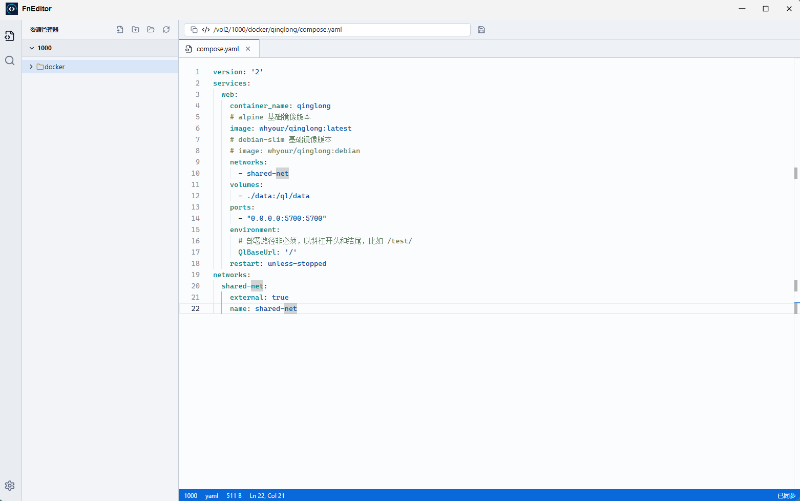

# FnEditor

一个适合部署在 fnOS / 飞牛 NAS 的 Web 代码编辑器。界面采用 VSCode 风格，左侧目录列表，右侧文件内容。

开源地址：[https://github.com/qdog2012/fneditor](https://github.com/qdog2012/fneditor)



## 本地开发

需要 Go 1.23+、Node.js 22+ 和 npm。后端使用 Go 标准库 `net/http`，前端使用 React、TypeScript 和 Vite。

```bash
npm install
npm run dev
```

默认监听 `http://localhost:39280`。`npm run dev` 会编译并启动 Go 后端，再启动 Vite；API 请求代理到本机 `39281` 端口。可通过 `PORT` 和 `FNEDITOR_DEV_BACKEND_PORT` 调整端口。开发时可用环境变量指定文件根目录：

```bash
FNEDITOR_ROOT=/path/to/my/files npm run dev
```

Windows PowerShell 可使用：

```powershell
$env:FNEDITOR_ROOT="D:\my-files"; npm run dev
```

生产模式：

```bash
npm run build
npm run start:prod
```

`npm run build` 生成前端 `dist` 和后端 `build/fneditor`（Windows 为 `build/fneditor.exe`）。生产环境可以直接执行 Go 程序，无需安装 Node.js 或 Go：

```bash
FNEDITOR_ROOT=/path/to/my/files ./build/fneditor
```

部署时保留可执行文件旁或上一级的 `dist` 目录，也可以通过 `FNEDITOR_APP_DIR` 指定包含 `dist` 的应用目录。端口默认 `39280`，可用 `PORT` 修改。`npm run start:prod` 是启动已构建程序的便利命令，需要 Node.js。

## 飞牛部署

容器默认读取 `/data`，建议把当前用户的“我的文件”或需要编辑的目录挂载到容器 `/data`：

```yaml
services:
  fneditor:
    build: .
    container_name: fneditor
    restart: unless-stopped
    ports:
      - "39280:39280"
    environment:
      - FNEDITOR_ROOT=/data
    volumes:
      - /vol1/1000:/data
```

如果你的“我的文件”实际路径不是 `/vol1/1000`，把 compose 里的左侧宿主路径改成飞牛文件管理器复制出来的实际路径即可。

## 原生 FPK 打包

如果不想用 Docker，可以按 `packaging/fpk-native` 做原生 `.fpk` 包。包内包含静态编译的 Go 后端和前端静态文件，无需携带 Node.js 运行时或 `node_modules`。

在 Linux 或 fnOS 打包环境中执行：

```bash
bash scripts/prepare-fpk-native.sh
```

脚本会生成 `build/fpk-native/fncode` staging 目录。随后执行：

```bash
bash scripts/package-fpk-native.sh
```

生成的 `.fpk` 位于 `build/fpk-output`。将新版本安装到飞牛后，桌面入口会使用 `index.cgi`，符合 fnOS 1.2.0701 的 CGI 校验要求。

GitHub 发布时，将版本号同步到 `package.json`、`package-lock.json` 和 `packaging/fpk-native/manifest`，更新 `RELEASE_NOTES.md`，然后推送对应版本标签（例如 `0.1.75`）。发布工作流会测试后端、构建 x86-64 FPK 并上传安装包和 SHA-256 校验文件到 GitHub Releases。

如果在 WSL 中从 `/mnt/c`、`/mnt/d` 这类 Windows 挂载目录执行脚本，脚本会自动把源码复制到 `~/.cache/fncode-fpk-src` 后再安装依赖，避免 Windows `node_modules` 和 Linux 原生依赖混用导致 `npm ci` 失败。后续打包命令需在这个副本目录中执行，生成的包也位于该目录的 `build/fpk-output`。

原生 FPK 优先检测飞牛“我的文件”目录，未找到时使用应用数据目录下的 `files`。安装后可在设置中修改根目录；选择会保存到应用状态文件中，服务重启后自动恢复。

打包默认面向本机架构，可用 `TARGET_ARCH=amd64` 或 `TARGET_ARCH=arm64` 交叉编译 Linux 后端。

后端测试：

```bash
npm run test:server
```

## 功能

- 左侧文件资源管理器默认显示根目录文件列表
- 点击文件后在 Monaco 编辑器中打开
- `Ctrl+S` / `Cmd+S` 保存
- 新建文件、新建文件夹、刷新文件树
- 搜索当前根目录内的文件名和文本内容
- 在设置里调整编辑器字号、自动换行和主题
- 文件树右键菜单支持打开、新建、重命名、复制路径、刷新、删除
- 编辑器标签右键菜单支持保存、关闭、关闭其他、定位到资源管理器
- 多标签打开文件，未保存状态提示
- 相对路径文件操作限制在当前根目录内，拒绝通过路径遍历或符号链接越界；`FNEDITOR_RESTRICT_ROOTS=1` 还限制切换目录和绝对路径打开/保存的范围（原生 FPK 默认开启）
